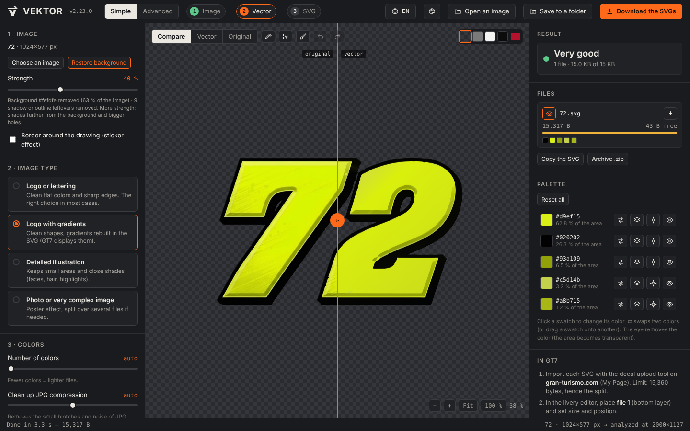

<p align="center"></p>

# Vektor

**Turn any PNG into Gran Turismo 7 livery decals — SVG files under the 15 KB limit, without losing the drawing.**

<p align="center">

[](https://github.com/AltKlin/Vektor/stargazers)
[](LICENSE)


</p>

<p align="center"><a href="../../releases/latest"><b>⬇ Download for Windows / macOS</b></a> · <a href="https://altklin.github.io/Vektor/">Web version</a></p>

<p align="center"></p>

## Why Vektor?

The Gran Turismo 7 livery editor only accepts SVG decals of **15,360 bytes max** per file. Generic vectorizers produce files that are far too big, use features GT7 can't render, or destroy the details when you shrink them. Vektor is built for exactly this limit.

Free, no account, zero dependencies: everything runs on your computer, no image is ever uploaded.

## Features

- **Flat colors and real gradients** — solid shapes by default; linear and radial gradients are rebuilt in the SVG when the image has them (GT7 displays them, but ignores opacity).
- **Fits in 15 KB** — a single file whenever possible; otherwise as few files as possible, stacked in the same frame for perfect alignment in game.
- **Picks the best trade-off automatically** — tries several curve precisions, measures how close each result is to your image, and drops the least visible details first when the budget runs out.
- **Clean edges** — sub-pixel edge placement from the source anti-aliasing (no staircase effect), sharp corners preserved.
- **Editable colors** — change, remove, merge or swap colors, remove the background in one click.
- **Edit one shape at a time** — the selection tool picks a single shape (one letter, one detail, a transparent hole) or every shape inside a box; give it a new color (one click on a color already in the image, or any color) or make it transparent without touching the rest.
- **Background removal with a strength slider** — removes the plain background from the border inward without crossing darker outlines; the slider sets the color tolerance and how big the little background-colored holes inside the design can be before they are filled with the surrounding color.
- **Sticker border** — adds a clean white (or any color) outline around the design, holes inside included, like a die-cut sticker.
- **JPG cleanup** — removes compression blotches and noise before tracing, without softening real edges.
- **Halftone smoothing** — dot patterns (comic shading) become a clean flat tone instead of noisy specks.
- **Undo / redo** — Ctrl+Z / Ctrl+Y (⌘Z / ⇧⌘Z on Mac) for every color and shape edit.
- **SVG import** — open an existing SVG (gradients, transparency, too big for GT7) and get a GT7-compatible version.
- **Auto-centering** — the SVG frame hugs the design and ignores tiny stray specks far from it, so the decal sits centered in GT7.
- **Update notice** — the app tells you when a new release is out on GitHub.
- **Image editor before conversion** — layers, selections, brush, clone, text, filters, background removal.
- **8 languages** — English, French, Spanish, German, Italian, Portuguese, Japanese and Chinese; follows your system language.
- **Interface themes** — 13 themes, including two full layouts (Starting grid, Garage).
- **Simple & advanced modes** — four guided steps to start, every fine setting for power users.

## Install

**Web, nothing to install:** https://altklin.github.io/Vektor/ — runs in Edge or Chrome, can be installed as an app (Install button in the address bar) and works offline. Handy when Windows Smart App Control blocks the setup.

**Windows 10 / 11** — download `Vektor-Setup.exe` from [Releases](../../releases/latest) and run it (per-user install, no admin rights). The app isn't code-signed yet: if SmartScreen appears, click *More info → Run anyway*.

**macOS 13+** (Apple Silicon & Intel) — download `Vektor-macOS.zip`, drag **Vektor.app** to Applications. First launch: *System Settings → Privacy & Security → Open Anyway*, or:

```sh
xattr -dr com.apple.quarantine /Applications/Vektor.app
```

**Any OS** — `dist/vektor.html` is the whole app in a single file; open it in a recent Chromium-based browser.

## Use it in GT7

1. Upload each SVG with the decal upload tool on [gran-turismo.com](https://www.gran-turismo.com) (My Page).
2. In the livery editor, place **file 1** (the bottom layer) and set its size and position.
3. If there are several files: **Duplicate** the layer, then **Replace** the decal with file 2 — same position, same size. Repeat in order up to the last file.

## Build

Requirements: Python 3. Everything else is plain HTML/JS with zero dependencies.

```sh
python3 build.py          # dist/vektor.html (single-file app)
python3 build.py --web    # + dist/web/ (installable web version)
./build-windows.sh        # dist/Vektor-Setup.exe (needs the Mono C# compiler)
zsh macos/build.sh        # Vektor.app (macOS, needs Xcode Command Line Tools)
```

- `src/engine.js` — vectorization engine (OKLab color clustering, region cleanup, contour tracing, Bézier fitting, byte-budget optimizer).
- `src/ui.html` — interface, image editor and preparation pipeline (background removal, halftone and JPG cleanup).
- `src/i18n/*.json` — translations, keyed by the English text.
- `windows/` — launcher (WebView2 window) and installer; `macos/` — native WKWebView app.

Pushing a `v*` tag builds the Windows and macOS releases with GitHub Actions.

## Part of AltKlin

Vektor is part of **[AltKlin](https://altklin.github.io)** — free, zero-dependency, clean-room alternatives to paid software.

If Vektor saved you time, a ⭐ helps a lot — it's how other GT7 players find it. Issues and ideas are welcome.

## License

[MIT](LICENSE) — made by [CodeX64](https://codexx64.github.io).
